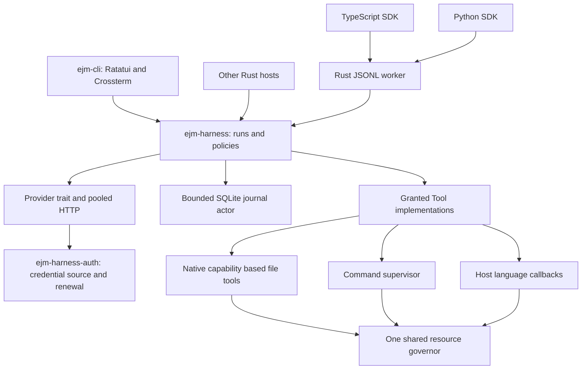

# Architecture

ejm-harness is a library and worker. ejm-cli is an independent Rust project
that demonstrates its public API. Terminal types, account UX, and platform
product code do not belong in the engine.

## Runtime ownership

A harness owns one provider, tool registry, context policy, run strategy,
governor, store actor, and bounded event broadcaster. Sessions are lightweight
state. They share those services. An agent awaiting a model does not own a
process. The CLI runtime uses two Tokio worker threads and at most four
blocking threads.

Agent capacity, model request capacity, and local job capacity are distinct.
The default envelope manages 100 active sessions, eight model requests, four
local jobs, and one heavy job. Reservations prevent admission from multiplying
load across agents. They estimate resources; platform monitoring and the
capability report describe the actual enforcement available.

Mutating tools serialize by canonical session working directory. Hosts that
need independent writers can supply separate checkout directories. Read tools
can proceed concurrently. Paths that overlap through different root directories
are not a general filesystem transaction system. External editors can still
race an optimistic file precondition.

## Deep modules and substitution

Keep each module responsible for a coherent decision. Traits exist at current
variable boundaries: `Provider`, `Tool`, `ContextPolicy`, and `RunStrategy`.
Constructors receive implementations. There is no dependency injection container.
The driver owns grants, validation, resource limits, and persistence even when a
host supplies its own strategy.

The store hides SQLite and its single bounded writer queue. The executor hides
admission, process ownership, pipe draining, and cancellation cleanup. Hosts
consume their public contracts instead of coordinating these details themselves.
Cargo graph checks enforce dependency direction.

`ejm-harness-auth` is a separate crate with no agent or frontend dependency. Providers
receive a credential source. Hosts own account controls, the callback listener,
browser presentation, and the choice of protected storage. The supplied local
store uses an exclusive cross-process transaction for token rotation. Authentication
does not grant repository tools or start a run.

## Turn and control semantics

One turn runs per session. Queued turns get distinct run IDs. SDK controls use
run identity, so an old handle cannot cancel or steer a newer queued turn.
Steering is consumed at safe checkpoints before model work and between tools.
It cannot undo a tool that has already started. Stop requests cancellation.

Acknowledging cancellation and finishing cleanup are separate milestones.
Native blocking work and command supervisors retain admission and effect
ownership until they actually stop. Custom tools must retain the execution token
when work outlives their async future. SDK callbacks use cooperative cancellation;
the SDK contract specifies ownership while callback cleanup remains outstanding.

## Persistence and failure

The private SQLite directory has one owner. The writer uses WAL and full
synchronization, a bounded request channel, and a database page budget. Durable
events have increasing sequence numbers. Live events are hints; lagging clients
replay bounded pages from the journal.

Before invoking a tool, the engine journals its call. Results close that call.
Restart adds an explicit uncertainty result for an interrupted call and does not
replay the effect. Tool identities are minted by the harness, including across
provider sessions. Ordered recovery also handles legacy reused IDs.

If completion cannot be persisted, the engine stops accepting new effects.
Hosts must surface the failed run instead of waiting for a durable event that
cannot be written. A full or unavailable state store is a visible failure. Raise
the configured storage budget or resolve the storage issue before reopening;
never erase a journal or rerun uncertain effects to hide the failure.

## Context and extension safety

Context is capped in bytes and model usage has token budgets. Recent context
first removes old turns, then retains the latest intent and complete recent tool
exchanges. It adds an omission note when compacting a long turn. The full event
journal remains available subject to its storage budget.

Native coding tools use directory capabilities for containment. Writes require
hash preconditions for existing files, reject ambiguous patches, and protect
repository metadata. Native tools are preferable to shell commands for file
operations because they avoid process creation and enforce predictable bounds.
Shell execution has its own explicit host grant and preserves ordinary semantics.
It is not an isolation boundary.

The SDK bridge is versioned JSONL with generated wire types. The host owns
callback code and its runtime. Registration is explicit. No repository extension
executes merely because a session is opened.

## Product direction and proof

Pi is a reference for a small extensible core and terminal composability.
ejm-harness concentrates on shared admission, resource ownership, recovery,
and reusable language APIs. ejm-cli concentrates on clear state, a responsive
composer, bounded output, discoverable controls, and reliable terminal recovery.

DeepSeek compatible APIs are implemented. No claim is made that this engine
reproduces an unpublished DeepSeek training or inference harness. Better coding
quality, lower model spend, and comparative speed require controlled workloads
against pinned competitors. They are product goals, not established evidence.

Linux kernel containment, Windows Job Objects, remote execution, automatic
worktree/team orchestration, local model inference, and packaged binary
distribution require separate implementation and evidence. Current capabilities
are reported explicitly instead of inferred from the Rust implementation.
